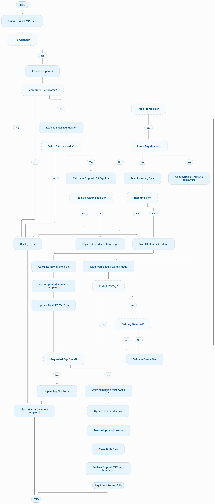

# MP3 Tag Reader and Editor Using C

## 1. Introduction

The **MP3 Tag Reader and Editor** is a menu-driven application developed using the C programming language. The main purpose of this project is to read, display, and modify metadata information stored in MP3 audio files.

An MP3 file contains audio data along with additional information called metadata. This metadata provides details about the audio file, such as the song title, artist name, album name, release year, genre, and comments.

This information is generally stored using a format called **ID3 (Identify an MP3)**. ID3 tags help users identify and organize audio files without opening or playing them.

The application allows users to view the existing metadata of an MP3 file and modify selected information according to their requirements. It performs file operations using C file handling functions and processes the metadata through binary file operations.

This project provides practical experience in file handling, structures, pointers, command-line arguments, memory management, and binary data processing in C.

## 2. Problem Statement

MP3 audio files contain metadata that describes the information about a song. Sometimes this information may be missing, incorrect, or outdated.

For example:
- A song may have an incorrect title.
- The artist name may be missing.
- The album name may be incorrect.
- The release year may not be available.
- The genre information may be incorrect.

Manually managing metadata across multiple audio files can be inconvenient.

To solve this problem, the MP3 Tag Reader and Editor application provides a simple way to read existing metadata and update selected tag information.

The application helps users understand and manage MP3 metadata through a command-line interface.

## 3. Objectives

The main objectives of this project are:

1. To develop an application using the C programming language.
2. To understand the internal structure of MP3 audio files.
3. To learn how ID3 metadata is stored inside MP3 files.
4. To read and display metadata from an MP3 file.
5. To modify selected metadata fields.
6. To understand file handling operations in C.
7. To gain practical experience with binary file reading and writing.
8. To understand the use of structures and pointers.
9. To implement command-line argument handling.
10. To improve programming, debugging, and problem-solving skills.

## 4. What is MP3?

MP3 stands for MPEG Audio Layer III.

It is a commonly used digital audio format that compresses audio data to reduce file size while maintaining acceptable sound quality.

An MP3 file generally contains:
- Audio data, which stores the actual sound.
- Metadata, which stores information about the audio file.

Metadata helps identify the song and provides information about its content.

## 5. What are ID3 Tags?

ID3 is a metadata format used in MP3 audio files.

It stores additional information about a song, such as its title, artist, album, year, and genre.

The ID3 information is stored in frames. Each frame contains a frame identifier, information about the frame size and flags, and the actual metadata data.

### Common ID3 Frames

| Frame ID | Description |
|---|---|
| TIT2 | Song Title |
| TPE1 | Artist Name |
| TALB | Album Name |
| TYER | Release Year in older ID3 versions |
| TDRC | Recording Time in ID3v2.4 |
| COMM | Comments |
| TCON | Genre |

### ID3v2 Header Structure

An ID3v2 header generally contains 10 bytes.

| Field | Size | Description |
|---|---:|---|
| Identifier | 3 bytes | Contains the characters ID3 |
| Version | 2 bytes | Specifies the ID3 version |
| Flags | 1 byte | Contains tag-level flags |
| Tag Size | 4 bytes | Specifies the size of the tag data |

The tag size is stored using a special format called synchsafe integers in ID3v2.

### ID3 Frame Structure

Each ID3v2.3 frame generally contains:

| Field | Size | Description |
|---|---:|---|
| Frame ID | 4 bytes | Identifies the metadata field |
| Frame Size | 4 bytes | Specifies the frame data size |
| Flags | 2 bytes | Contains frame-specific flags |
| Frame Data | Variable | Stores the actual metadata |

The exact frame structure and size encoding depend on the ID3 version.

## 6. Features of the Project

### 6.1 MP3 Tag Reader

The reader operation is used to extract and display metadata from an MP3 file.

Features include:

- Opens the specified MP3 file.
- Reads the ID3 header.
- Checks the ID3 information.
- Identifies the available metadata frames.
- Extracts frame identifiers and frame sizes.
- Reads the actual metadata content.
- Displays the extracted information in a readable format.

### 6.2 MP3 Tag Editor

The editor operation allows users to modify selected metadata information.

Features include:

- Opens the MP3 file for editing.
- Reads the existing ID3 tag information.
- Displays the available metadata fields.
- Allows the user to select a field.
- Accepts new metadata from the user.
- Updates the selected frame.
- Saves the modified MP3 file.

### 6.3 Command-Line Interface

The application uses command-line arguments to identify the operation and the MP3 file.

The user can select the required operation without using a graphical interface.

## 7. Technologies Used

| Technology | Purpose |
|---|---|
| C Programming | Main development language |
| GCC | C compiler |
| Linux / Ubuntu (WSL) | Development environment |
| Visual Studio Code | Source code editor |
| Git | Version control |
| GitHub | Source code hosting |

## 8. C Programming Concepts Used

### 8.1 File Handling

File handling is one of the most important concepts used in this project.

It allows the application to access MP3 files and perform reading and writing operations.

Functions used:

- `fopen()` – Opens a file in the required mode.
- `fread()` – Reads binary data from a file.
- `fwrite()` – Writes binary data into a file.
- `fseek()` – Moves the file pointer to a specific position.
- `ftell()` – Returns the current file pointer position.
- `fclose()` – Closes an opened file.

### 8.2 Structures

Structures are used to group related data members into a single user-defined data type.

They help organize MP3 file information, metadata details, and file pointers.

### 8.3 Pointers

Pointers are used to store memory addresses and access data indirectly.

They are useful when working with file pointers, structures, and dynamically allocated memory.

### 8.4 Command-Line Arguments

Command-line arguments allow users to pass information to a program during execution.

In C, the `main()` function can receive arguments using:

`int main(int argc, char *argv[])`

- `argc` represents the number of command-line arguments.
- `argv` stores the argument strings.

The program uses these arguments to identify the operation and input MP3 filename.

### 8.5 String Handling

String handling is used to process metadata values such as song titles, artist names, and album names.

Functions from `string.h` can be used for copying, comparing, and measuring strings.

### 8.6 Binary File Processing

MP3 files contain binary information. Therefore, binary file operations are used to read and write metadata without treating the entire file as a text file.

### 8.7 Dynamic Memory Management

Dynamic memory allocation can be used when memory requirements depend on the size of the metadata being processed.

Functions include:
- `malloc()`
- `calloc()`
- `realloc()`
- `free()`

## 9. Project Architecture

The project is organized into separate source and header files to make the code easier to understand, maintain, and modify.

Typical file responsibilities:

| File | Responsibility |
|---|---|
| main.c | Handles program execution and operation selection |
| view.c | Contains MP3 metadata reading functionality |
| edit.c | Contains MP3 metadata editing functionality |
| mp3_header.h | Contains structure declarations and function prototypes |
| README.md | Contains project documentation |

The actual file names and responsibilities should match the source code in the repository.

## 10. Working Principle of the Project

The application works mainly in two operations: reading and editing.

### 10.1 Reading Operation

The reading operation extracts the metadata information from an MP3 file.

Steps:

1. The user provides the MP3 filename.
2. The application checks the command-line arguments.
3. The program opens the MP3 file in binary read mode.
4. The ID3 header is read from the file.
5. The program checks the ID3 identifier and version.
6. The total tag size is extracted.
7. The program reads the available frames.
8. Each frame identifier is identified.
9. The frame size is calculated.
10. The metadata content is read.
11. The extracted information is displayed to the user.
12. The file is closed after completing the operation.

### 10.2 Editing Operation

The editing operation modifies the selected metadata field.

Steps:

1. The user provides the MP3 filename.
2. The application checks the input arguments.
3. The MP3 file is opened.
4. The existing ID3 header is read.
5. The program identifies the available frames.
6. The user selects the metadata field to modify.
7. The program accepts the new value.
8. The new frame data is prepared.
9. The frame size and tag size are updated where necessary.
10. The modified metadata is written into the output file or updated file, depending on the implementation.
11. The modified file is saved.
12. The file is closed.

## 11. Compilation

To compile the project, open the terminal inside the project directory.

Use GCC to compile the required source files.

Example:

```bash
gcc main.c view.c edit.c -o mp3
```

If your project contains additional source files, include them in the compilation command.

## 12. Execution

After successful compilation, execute the program:

```bash
./mp3
```

The application accepts the required command-line arguments according to the implementation.

For example, if the application supports `-v` for viewing and `-e` for editing, the commands may look like:

```bash
./mp3 -v sample.mp3
```

```bash
./mp3 -e sample.mp3
```

These commands are examples; use the exact argument format implemented in your program.

## 13. Sample Output

### Reading MP3 Tags

Illustrative output:

```text
-----------------------------------------
           MP3 TAG READER
-----------------------------------------

TITLE       : Sample Song
ARTIST      : Sample Artist
ALBUM       : Sample Album
YEAR        : 2024
COMMENT     : Sample Comment
GENRE       : Pop

-----------------------------------------
```

### Editing MP3 Tags

Illustrative output:

```text
-----------------------------------------
           MP3 TAG EDITOR
-----------------------------------------

Select the tag to edit:

1. Title
2. Artist
3. Album
4. Year
5. Comment
6. Genre

Enter your choice: 1

Enter new title: New Song Title

Title updated successfully!

-----------------------------------------
```

*Note: These are example outputs. Actual output depends on the MP3 file and the implemented program.*

## 14. Error Handling

Error handling is important to prevent unexpected program failures.

The application should handle situations such as:

- MP3 file not found.
- Unable to open the specified file.
- Invalid command-line arguments.
- Unsupported file format.
- Invalid ID3 header.
- Invalid or incomplete frame data.
- Failure while reading the file.
- Failure while writing the modified data.
- Invalid user input.

Appropriate error messages help users understand the problem and take corrective action.

## 15. Advantages

- Provides an easy way to view MP3 metadata.
- Allows users to modify selected metadata fields.
- Uses a simple command-line interface.
- Helps understand binary file processing.
- Provides practical experience with C file handling.
- Improves knowledge of pointers and structures.
- Demonstrates modular programming.

## 16. Applications

- Reading metadata from MP3 audio files.
- Updating song information.
- Organizing music collections.
- Correcting missing or incorrect audio metadata.
- Learning file format processing.
- Understanding binary data manipulation.

## 17. Future Enhancements

The project can be improved with additional features:

1. Support for more ID3 versions.
2. Support for additional metadata frames.
3. Support for album artwork.
4. Batch processing of multiple MP3 files.
5. Improved input validation.
6. Better error handling.
7. Graphical user interface.
8. Support for additional audio formats.

## 18. Learning Outcomes

By developing this project, I gained practical knowledge of:

- C programming and modular programming.
- File handling using standard C library functions.
- Reading and writing binary files.
- Understanding MP3 file structure.
- Understanding ID3 metadata and frame processing.
- Working with pointers and structures.
- Handling command-line arguments.
- Processing strings and binary data.
- Debugging and testing applications.
- Using Git and GitHub for project management.

## 19. Conclusion

The MP3 Tag Reader and Editor project provides practical experience in developing a real-world application using the C programming language.

The project demonstrates how metadata can be extracted, displayed, and modified inside MP3 audio files using file handling and binary data processing techniques.

Through this project, I developed a better understanding of file operations, pointers, structures, command-line arguments, and memory management.

Overall, this project improved my C programming knowledge and problem-solving skills while providing hands-on experience with file format processing.

## 20. Author

**Pompana Gouda K**

GitHub Profile:  
https://github.com/PompanaGoudak

Project Repository:  
https://github.com/PompanaGoudak/C-MP3-Tag-Reader-Editor

---

**Project:** MP3 Tag Reader and Editor  
**Language:** C  
**Domain:** File Handling and Binary Data Processing
## 1. Complete Project Flowchart


## 2. MP3 Tag Viewing Flowchart


## 3. MP3 Tag Editing Flowchart


